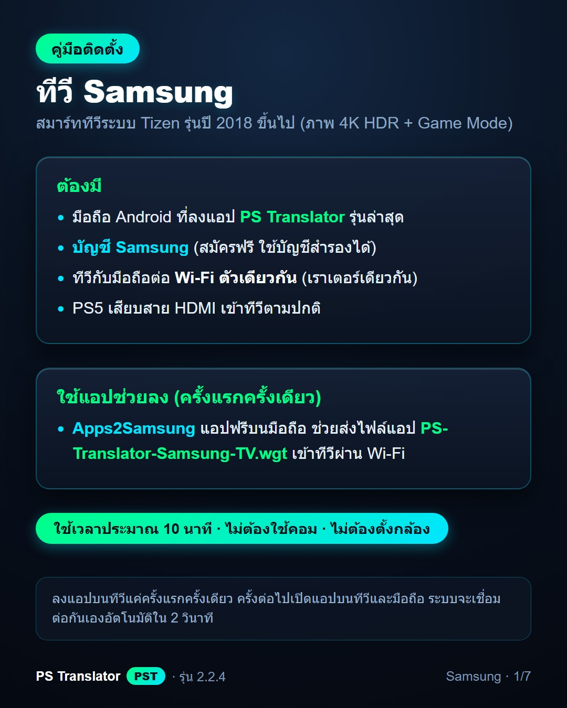
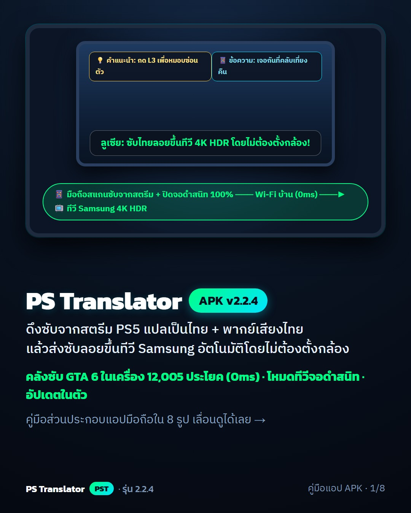

# 🎮 PS Translator (Android APK)

  

  <b>แอปพลิเคชันสตรีมเกม PlayStation 5 (PS5) และ PlayStation 4 (PS4) พร้อมระบบตรวจจับซับไตเติล แปลภาษาไทย และพากย์เสียงไทยแบบเรียลไทม์</b> 
  <i>รองรับสมาร์ทโฟน แท็บเล็ต Android และโหมด Samsung DeX เต็มรูปแบบ</i>

  
  
  
  
  

---

## 📖 สารบัญ (Table of Contents)
1. [ภาพรวมและจุดเด่น (Overview)](#-ภาพรวมและจุดเด่น-overview)
2. [ฟีเจอร์การทำงานทั้งหมด (Key Features)](#-ฟีเจอร์การทำงานทั้งหมด-key-features)
3. [ดาวน์โหลดและติดตั้ง (Download & Installation)](#-ดาวน์โหลดและติดตั้ง-download--installation)
4. [ขั้นตอนที่ 1: เตรียม 2 บัญชี PSN สำหรับเล่นบนทีวีพร้อมแปลภาษา (2-Account Setup)](#-ขั้นตอนที่-1-เตรียม-2-บัญชี-psn-สำหรับเล่นบนทีวีพร้อมแปลภาษา-2-account-setup)
5. [ขั้นตอนที่ 2: ตั้งค่าเชื่อมต่อและลงทะเบียน PS5 ในครั้งแรก (Initial Setup)](#-ขั้นตอนที่-2-ตั้งค่าเชื่อมต่อและลงทะเบียน-ps5-ในครั้งแรก-initial-setup)
6. [ขั้นตอนที่ 3: ขั้นตอนการเข้าเล่นจริงและใช้งานระบบแปลภาษา (How to Use)](#-ขั้นตอนที่-3-ขั้นตอนการเข้าเล่นจริงและใช้งานระบบแปลภาษา-how-to-use)
7. [ทริคแนะนำเพื่อให้การแปลแม่นยำที่สุด 100% (Pro Tips)](#-ทริคแนะนำเพื่อให้การแปลแม่นยำที่สุด-100-pro-tips)
8. [การใช้งานในโหมด Samsung DeX](#-การใช้งานในโหมด-samsung-dex)

---

## 🌟 ภาพรวมและจุดเด่น (Overview)

**PS Translator** ได้รับการพัฒนาขึ้นโดยดัดแปลงจากแกนหลักของ Chiaki สตรีมมิ่งไคลเอนต์โอเพนซอร์สยอดนิยม โดยฝังระบบประมวลผลภาพ **OCR (Optical Character Recognition)**, **ระบบแปลภาษาไทย**, **ระบบส่งซับลอยขึ้นทีวี Samsung (`.wgt`)** และ **ระบบพากย์เสียงไทยอัตโนมัติ** เข้าไปในตัวแอปพลิเคชัน ทำให้เกมเมอร์ชาวไทยสามารถเล่นเกมภาษาอังกฤษบนเครื่อง PS5 / PS4 ได้อย่างเพลิดเพลิน เข้าใจบทสนทนาและเนื้อเรื่องของเกมได้ 100% โดยไม่ต้องพึ่งพาโปรแกรมเสริมภายนอก

### 🖼️ คู่มือแบบมีรูปทีละขั้น (แยกฝั่งทีวี Samsung vs ฝั่งแอปมือถือ APK)

| คู่มือแยกตามอุปกรณ์ | รายละเอียด |
|---|---|
| 📺 **[คู่มือติดตั้งและใช้งานบนทีวี Samsung (7 ภาพทีละขั้นตอน)](docs/tv/samsung.md)** | วิธีโหลดไฟล์ `.wgt`, ดูเลข IP มือถือ, เปิดโหมดนักพัฒนาบนทีวี `1 2 3 4 5`, ลงแอปผ่าน `Apps2Samsung` และเชื่อมต่ออัตโนมัติ |
| 📱 **[คู่มือวิธีใช้แอป PS Translator บนมือถือ APK (8 ภาพครบทุกส่วน)](docs/phone/how-to-use.md)** | รู้จักปุ่มบนหน้าจอหลัก, ปุ่ม `📺 โหมดทีวี` (ปิดจอดำสนิท 100%), แถบสไลด์เลื่อนตำแหน่งซับขึ้น-ลง, ลากกรอบอ่านซับ, เสียงพากย์ไทย & คลังซับ `0ms` |

  
  

---

## 🚀 ฟีเจอร์การทำงานทั้งหมด (Key Features)

### 1. ระบบประวัติซับไตเติลเรียงซ้อนให้อ่านทัน (Smart Subtitle Cascade)
- **หมดปัญหาอ่านซับไม่ทัน:** เมื่อมีบทพูดใหม่ขึ้นมา ซับก่อนหน้าจะไม่หายไปทันที แต่จะถูกเลื่อนถัดลงมาข้างล่าง เพื่อให้ผู้เล่นอ่านจบประโยคได้สบายตา
- **ไล่ระดับความจาง (Dimmer / Fade Alpha):** ซับใหม่จะสว่างเด่นชัดที่สุด (Alpha 1.0) ส่วนซับก่อนหน้าจะค่อยๆ ปรับความโปร่งแสงให้จางลง (Alpha 0.65 และ 0.35) เพื่อให้แยกแยะบทพูดใหม่และเก่าได้ง่าย
- **จัดการเมื่อข้อความล้น & ซ่อนอัตโนมัติใน 10 วินาที:** เมื่อข้อความเกิน 1-3 แถวตามที่ตั้งค่าไว้ ซับเก่าที่สุดจะเลื่อนออกอัตโนมัติ และหากไม่มีบทพูดใหม่เข้ามาครบ **10 วินาที** กล่องซับจะซ่อนตัวเองอัตโนมัติเพื่อไม่ให้บังหน้าจอเกม

### 2. ซับไตเติลขึ้นตรงกลางหน้าจอ (Center Screen Subtitle)
- ซับใหม่จะปรากฏขึ้นบริเวณ **ตรงกลางหน้าจอ (Center)** อย่างเด่นชัด และซับเก่าเรียงลงข้างล่าง ไม่ต้องก้มมองขอบจอด้านล่าง
- สามารถสลับตำแหน่งกลับไปเป็น **ด้านล่างจอ (Bottom)** ได้ตลอดเวลาผ่านเมนูตั้งค่า

### 3. ปรับแต่งตัวหนังสือ สี ขนาด และกรอบพื้นหลังแบบสดๆ (Live Subtitle Styling)
- **ฟอนต์ซับหลักหนาอ่านชัด (ไม่มีเงา/ไม่มีขอบดำซ้อน):** ซับที่แปลหลักใช้ฟอนต์ผสม **`GTA Art Deco + Prompt SemiBold`** หนาและคมชัด ส่วนเมนูและหน้าแรกใช้ฟอนต์คลีนเหมือนเดิม
- **กรอบพื้นหลังซับลอย ไม่มีขอบ ปรับความโปร่งแสงและเปิด/ปิดได้ + ย่อขยายตามความยาวซับ:** กรอบพื้นหลังโปร่งแสงไม่มีเส้นขอบ (`fit-content`) ย่อ-ขยายขนาดอัตโนมัติตามความยาวข้อความซับ พร้อมสวิตช์ **เปิด/ปิดกรอบพื้นหลังซับ** และเลือกความโปร่งแสง (`0% / 40% / 80% / 100%`)
- **เลือกสีตัวหนังสือได้ 6 สี & ปรับขนาด `10 sp – 80 sp`:** เขียวนีออน, ขาวสว่าง, ฟ้าไซเบอร์, เหลืองทอง, ส้มสด, ชมพูหวาน พร้อมปุ่มลัดและแถบเลื่อนละเอียดทีละ `1 sp`

### 4. สตรีมตรงจาก PS5 / PS4 ความหน่วงต่ำมาก (Ultra-Low Latency Streaming)
- สตรีมภาพและเสียงความละเอียดสูงสุด **1080p ที่ 60 FPS** ลื่นไหล ไม่กระตุก
- รองรับการเชื่อมต่อจอยเกม **DualSense (PS5)**, DualShock 4, จอยบลูทูธมาตรฐาน (Xbox, โทรศัพท์, จอยหนีบ Type-C) พร้อมระบบสั่น (Haptics)
- มีปุ่มควบคุมเสมือนบนหน้าจอสัมผัส (On-Screen Touch Controls) ปรับเปิด/ปิดการแสดงผลได้อิสระ

### 5. ตรวจจับซับไตเติลและแปลภาษาไทยแบบเรียลไทม์ (Live OCR & Translation)
- สแกนอ่านแถบซับไตเติลภาษาอังกฤษในเกมอัตโนมัติด้วยเทคโนโลยี OCR ความละเอียดสูง
- **Smart Typo Corrector:** ระบบแก้คำผิดอัจฉริยะ ป้องกันการอ่านสับสนของตัวอักษร เช่น ระหว่างตัว `c` กับ `e` หรือสระตกหล่น
- ประมวลผลแปลประโยคภาษาอังกฤษเป็นภาษาไทยทันที ให้สำนวนบทสนทนาที่สละสลวย เข้ากับเนื้อหาเกม

### 6. ระบบพากย์เสียงภาษาไทย & 3 โหมดคิวเสียง (Thai Voice Dubbing & TTS Queue)
- สังเคราะห์และพากย์เสียงภาษาไทยอัตโนมัติทันทีที่ตัวละครในเกมพูด (รองรับส่งเสียงออกหูฟัง Bluetooth อัตโนมัติ)
- **ระบบแยกเสียงตัวละคร:** วิเคราะห์และเลือกเสียงพากย์ชายหรือหญิงให้ตรงตามบทสนทนา
- **ปรับความเร็วเสียงพากย์ (Speech Speed):** ปรับความเร็วได้ตั้งแต่ `1.0x` จนถึง `1.5x` (แนะนำ `1.25x`)
- **3 โหมดคิวเสียงพากย์:** เลือกได้ระหว่าง **อ่านจบประโยค (ต่อคิว)**, **ทันใจตามซับใหม่ (ตัดขึ้นทันที)**, และ **Smart Queue (ลูกผสม — แนะนำ)**

### 7. ปุ่มปิดเฉพาะเสียงเกม (Mute Game Audio) & จำการตั้งค่า + การเชื่อมต่อ PS5 ถาวร
- สั่งปิดเฉพาะเสียงเกมบนมือถือ/แท็บเล็ต เพื่อให้ได้ยินเสียงพากย์ไทยหรือเสียงจากทีวีชัดเจน (จำสถานะปิดเสียงเกมไว้ให้หลังออกแอป)
- **บันทึกการตั้งค่าทั้งหมดและการเชื่อมต่อ PS5 ถาวร (หลังออกแอป & หลังอัปเดต):** จำค่าตั้งค่าทุกอย่าง (ซับ, เสียงพากย์, สี/ขนาด/ตำแหน่งซับ, กรอบสแกน, API Key, โหมดจอ, เสียงเกม) พร้อมบันทึก IP และการจับคู่ PS5 อัตโนมัติ มีระบบสำรอง/กู้คืนอัตโนมัติที่ `Documents/PS_Translator/ps_translator_backup.json` และปุ่ม **💾 ส่งออก / 📂 นำเข้าไฟล์สำรอง** ในเมนูอัปเดตหน้าแรก

### 8. โหมดจอดำแสดงเฉพาะตัวหนังสือ (Text-Only Mode)
- สลับหน้าจอปิดภาพเกมชั่วคราว ให้เหลือเฉพาะตัวหนังสือซับไตเติลภาษาไทยขนาดใหญ่บนพื้นหลังดำสนิท

### 9. ธีม Vice City, ฟอนต์ผสม GTA Art Deco + Prompt Light, การ์ดแชท GTA 6 (ซ้าย/ขวา) และลิ้นชักปุ่มลัด
- **ฟอนต์ผสม `GTA Art Deco + Prompt Light`:** ภาษาอังกฤษและตัวเลขใช้สไตล์ GTA Art Deco คู่กับภาษาไทย Prompt Light อ่านง่ายคมชัดทั้งบนมือถือและทีวี Samsung
- **ธีมเมนูตั้งค่า Vice City + Liquid Glass & Spring Physics:** เมนูกระจกโปร่งแสงโทนชมพูนีออน/ส้มซันเซ็ต/มิ้นต์เด้งจากปุ่ม `☰` พร้อมฟิสิกส์ยุบตัว/เด้งสปริงเวลาแตะ
- **โหมดโซนป๊อปอัพอัตโนมัติ (ซ้าย / ขวา) แยกดีไซน์ + แถบเลื่อนขึ้น-ลงอิสระ:**
  - **ฝั่งซ้าย (คำแนะนำ/Tutorial):** ดีไซน์กล่องเทาเข้มเหมือนในเกม GTA 6 ไม่มีหัวข้อหรือเครื่องหมายถูก พร้อมระบบขยายภาพ OCR 2x + ขอบกันตัดคำให้อ่านคำแนะนำครบเป๊ะทุกคำ
  - **ฝั่งขวา (ข้อความแชท):** ดีไซน์ **GTA 6 Chat Bubble** พร้อมระบบรอข้อความพิมพ์จนครบก่อนแปล
  - **แถบเลื่อนตำแหน่งขึ้น-ลง (`0%–100%`) แยกอิสระทั้งซ้ายและขวา** ซิงค์ทั้งมือถือและทีวี Samsung แบบเรียลไทม์
- **โหมดแปลเฉพาะจุด (สีฟ้า):** กดปุ่มไอคอนมุมขวาล่างเพื่อแปลเอกสาร/จดหมายแบบไม่ชนกับซับ (สลับโหมดได้จากลิ้นชักด้านบน)
- **ลิ้นชักปุ่มลัดด้านบน (Top Quick Drawer):** แตะหรือปัดแถบโปร่งแสงตรงกลางขอบบนเพื่อเปิด/ปิด **พากย์**, **เสียงเกม**, **ซับ**, **กรอบแปล**, และสลับโหมด **เฉพาะจุด / ป๊อปอัพ**

### 10. ฐานข้อมูลคำแปลในเครื่อง (Local Cache 0ms) + ซับ GTA 6 Part 1–4 (`15,868 ประโยค`) สำนวนอเมริกันเรียวๆ
- **แปลทันทีใน `0ms` ไม่ต้องรอเน็ต:** ระบบฐานข้อมูล SQLite ในเครื่องจะจำประโยคที่เคยแปลแล้ว และรองรับการฝัง/นำเข้าชุดคำแปลเกมล่วงหน้า
- **ฝังฐานข้อมูล GTA 6 Part 1–4 รวม `15,868 ประโยค` มาพร้อมในตัวแอป:** ครอบคลุมเนื้อเรื่องยาวกว่า **13 ชั่วโมง 20 นาทีแรก** อัปเกรดสำนวนภาษาพูดสไตล์อเมริกันสมัยใหม่ (คำหยาบ คำแสลง คำอุทานเรียวๆ เป็นธรรมชาติ ไม่แข็งเป็นทางการ) ทั้งในคลังแคชและ Prompt AI แปลสด
- **ระบบจับคู่คำแปลอัจฉริยะ 3 ชั้น (แม่นยำสูงไม่แปลมั่ว):**
  1. **Exact Match (`0ms`):** ตรงเป๊ะทั้งประโยค
  2. **OCR-Skeleton Match (`0ms`):** จับคู่ได้ทันทีแม้ OCR ตอนเล่นจริงจะอ่านตัว `I/l/1`, `O/0`, เว้นวรรค หรือเครื่องหมายวรรคตอนเพี้ยน
  3. **Exact Levenshtein Fuzzy Match (`≥ 90%`):** จับคู่ประโยคที่มีตัวอักษรเพี้ยน 1–2 ตัวอย่างแม่นยำ พร้อม **แยกคลังแคชซับพูดออกจากกล่องข้อความแนะนำ (Popup) 100%**
- **ปุ่ม `"นำเข้า .DB"`:** สามารถนำเข้าไฟล์ `.db` หรือ `.tsv` ของพาร์ทถัดๆ ไปหรือเกมอื่นมารวมเพิ่มเข้าในเครื่องได้ทันทีโดยไม่ต้องลงแอปใหม่

### 11. รองรับ API แปล 7 ค่าย + เซิร์ฟเวอร์สำรอง + สวิตช์เปิด/ปิดเสียงพากย์
- รองรับค่ายแปลภาษาได้หลากหลาย: **Google Translate (ฟรี พร้อมเซิร์ฟเวอร์สำรองอัตโนมัติ)**, **Gemini AI (`flash-lite`)**, **Groq (เร็วสุดในสาย AI)**, **Cerebras**, **OpenAI**, **OpenRouter**, และ **Custom OpenAI-Compatible URL**
- **สวิตช์เปิด/ปิดเสียงพากย์ (Master Dubbing Toggle):** ปิดเสียงพากย์เพื่อแปลเฉพาะตัวหนังสืออย่างเดียว หรือเปิดพากย์ด้วย **TTS ในเครื่อง** / **Gemini AI TTS** ได้อิสระ

### 12. ส่งซับลอยขึ้นทีวี Samsung โดยตรง (`PS-Translator-Samsung-TV.wgt`) & อัปเดตแอปในตัว
- **ส่งซับขึ้นทีวี Samsung (Tizen 2018+) แบบไร้สาย:** ติดตั้งไฟล์ **`PS-Translator-Samsung-TV.wgt`** บนทีวี Samsung (ผ่านแอป `Apps2Samsung`) เพื่อเปิดภาพ HDMI ของ PS5 เป็นพื้นหลังในแอปทีวี และให้มือถือส่งซับไทย + ป๊อปอัพซ้าย/ขวา + โน้ตแปลเฉพาะจุดขึ้นไปลอยทับบนจอทีวีอัตโนมัติในวง Wi-Fi บ้าน (จับคู่อัตโนมัติใน 2 วินาที ไม่ต้องกรอกรหัส 6 หลัก และไม่ต้องตั้งกล้องส่องทีวี)
- **ระบบอัปเดตแอปในตัว (`อัปเดตแอปในตัว`) & ซิงค์ซับจากคลาวด์ (`ซิงค์ซับล่าสุด`):** กดซิงค์คลังซับพาร์ทใหม่จากคลาวด์หรือกดอัปเดตตัวแอปเป็นเวอร์ชันล่าสุดได้จากในแอปโดยตรง ไม่ต้องเปิดเว็บไปโหลดไฟล์ใหม่เอง

### 13. รองรับ Samsung DeX & Multi-Window เต็มรูปแบบ
- เสียบสายต่อภาพขึ้นจอคอมพิวเตอร์หรือทีวีในโหมด **Samsung DeX** ได้อย่างสมบูรณ์แบบ
- ย่อ/ขยายหน้าต่างแบบอิสระ (Pop-up View) และคลิกเมาส์ทำงานอื่นขณะสตรีมเกมได้โดยที่สัญญาณสตรีมเกมและการแปลไม่หลุด

---

## 📲 ดาวน์โหลดและติดตั้ง (Download & Installation)

1. เข้าไปที่หน้าดาวน์โหลดเวอร์ชันล่าสุดบน GitHub:  
   👉 **[ดาวน์โหลด PS-Translator.apk & PS-Translator-Samsung-TV.wgt (v2.2.10)](https://github.com/teeradream/ps-translator/releases/latest)**
2. แตะดาวน์โหลดไฟล์ **`PS-Translator.apk`**
3. แตะที่ไฟล์เพื่อทำการติดตั้ง:
   - หากระบบแจ้งเตือนความปลอดภัย ให้เลือก **"อนุญาตการติดตั้งจากแหล่งนี้" (Allow install from unknown apps)**
4. เมื่อติดตั้งเสร็จ ไอคอน **PS Translator** จะปรากฏบนหน้าจออุปกรณ์ของท่าน

---

## 👥 ขั้นตอนที่ 1: เตรียม 2 บัญชี PSN สำหรับเล่นบนทีวีพร้อมแปลภาษา (2-Account Setup)

> **💡 แนะนำให้อ่านและทำขั้นตอนนี้ก่อนลงทะเบียนเครื่อง PS5!**  
> โดยปกติหากใช้ **บัญชี PSN เดียวกัน** ทั้งบนทีวีและในแอป Remote Play เวลาเชื่อมต่อสตรีม จอย **DualSense** ที่ต่ออยู่กับเครื่อง PS5 จะถูกตัดการเชื่อมต่อทันที  
> **การใช้ 2 บัญชี** จะช่วยให้คุณ **ใช้จอย DualSense เล่นบนทีวี 4K ได้ตามปกติ (0 ดีเลย์, สั่นเต็มระบบ, เก็บ Trophy เข้าไอดีหลัก)** พร้อมวางมือถือ/แท็บเล็ตไว้ข้างๆ เพื่อแปลซับไทยและพากย์เสียงไทยไปพร้อมกันได้

*(หมายเหตุ: หากคุณตั้งใจเล่นบนหน้าจอมือถือ/แท็บเล็ตโดยตรง ไม่ได้เล่นบนทีวี สามารถใช้บัญชีหลักเพียงบัญชีเดียวแล้วข้ามไปขั้นตอนที่ 2 ได้เลย)*

### การเตรียมบัญชีบนเครื่อง PS5 (ทำครั้งเดียว)
1. เตรียมบัญชี PSN บนเครื่อง PS5 ให้มี **2 บัญชี**:
   - **`Account A` (บัญชีหลัก):** บัญชีที่คุณใช้เล่นเกมและเก็บเซฟ/Trophy บนทีวีตามปกติ
   - **`Account B` (บัญชีสำรอง):** สร้างเพิ่มอีก 1 บัญชีฟรี (ต้องล็อกอิน PSN ให้เรียบร้อย) เพื่อใช้เชื่อมเข้าแอป **PS Translator** โดยเฉพาะ
2. *(แนะนำ)* ที่ **`Account A`** ให้เข้าไปที่ **Settings (การตั้งค่า) > Users and Accounts (ผู้ใช้และบัญชี) > Other (อื่นๆ) > Console Sharing and Offline Play** แล้วกด **Enable** ไว้ด้วย

---

## 🎮 ขั้นตอนที่ 2: ตั้งค่าเชื่อมต่อและลงทะเบียน PS5 ในครั้งแรก (Initial Setup)

*(ทำเพียงครั้งแรกครั้งเดียว ระบบจะบันทึกเครื่องไว้ตลอดไป)*

### 2.1 ตั้งค่าที่เครื่อง PS5
1. ตรวจสอบให้แน่ใจว่า **เครื่อง PS5 และอุปกรณ์ Android เชื่อมต่อ Wi-Fi เครือข่ายเดียวกัน** (แนะนำ Wi-Fi 5GHz หรือต่อสาย LAN ที่เครื่อง PS5)
2. **สลับ User บนเครื่อง PS5 ไปที่บัญชีสำรอง (`Account B`)** *(หากเล่นแบบ 2 บัญชี)* — หรือใช้บัญชีหลักหากเล่นบนมือถือเครื่องเดียว
3. ไปที่ **Settings (การตั้งค่า)** > **System (ระบบ)** > **Remote Play (การเล่นระยะไกล)**
4. เปิดสวิตช์ **Enable Remote Play (เปิดใช้งานการเล่นระยะไกล)** ให้เป็นสีเขียว
5. เลือกเมนู **Link Device (เชื่อมโยงอุปกรณ์)** > หน้าจอ PS5 จะแสดง **รหัสตัวเลข PIN 8 หลัก** พร้อมเวลานับถอยหลัง 300 วินาที

### 2.2 ลงทะเบียนในแอป PS Translator
1. เปิดแอป **PS Translator** บนอุปกรณ์ Android
2. แอปจะค้นหาเครื่อง PS5 ในเครือข่ายอัตโนมัติ (จะปรากฏชื่อเครื่อง เช่น `PS5-xxx`) — หากไม่พบสามารถกดปุ่ม `+` เพิ่ม IP ของเครื่อง PS5 เองได้
3. แตะเลือกที่เครื่อง PS5 แล้วเลือก **Register (ลงทะเบียน)**
4. กรอกข้อมูลสำคัญ 2 ส่วน (**ต้องใช้ข้อมูลของบัญชีที่กำลังเปิด PIN อยู่บน PS5!**):
   - **PSN Account ID (Base64):** กรอกรหัส Account ID ของ **`Account B`** *(สำหรับแบบ 2 บัญชี)* สามารถหาได้ผ่านเว็บช่วยเหลือ เช่น:
     - [psn.flGen.com](https://psn.flgen.com/)
     - [pyrosoft.pro/psnid/](https://pyrosoft.pro/psnid/)  
     *(เพียงพิมพ์ชื่อ PSN Online ID ลงไป แล้วคัดลอกรหัส Account ID มาวางลงในช่อง)*
   - **PIN:** นำรหัส PIN 8 หลักที่ปรากฏบนหน้าจอ PS5 มากรอก
5. แตะปุ่ม **Register** เพื่อยืนยัน > เมื่อสำเร็จสถานะจะเปลี่ยนเป็นพร้อมสตรีม

---

## 🕹️ ขั้นตอนที่ 3: ขั้นตอนการเข้าเล่นจริงและใช้งานระบบแปลภาษา (How to Use)

### 3.1 การเชื่อมต่อเข้าเล่นจริงทุกครั้ง (แบบ 2 บัญชีคู่กับทีวี)
1. **เปิดแอป PS Translator** บนมือถือ/แท็บเล็ต แล้วแตะชื่อเครื่อง PS5 เพื่อเชื่อมต่อ *(แอปจะเชื่อมเข้าเครื่องในชื่อ **`Account B`**)*
2. **หยิบจอย DualSense** ที่ต่ออยู่กับเครื่อง PS5 กดปุ่ม **`PS`** ขึ้นมา แล้วเลือกสลับเข้า **`Account A` (บัญชีหลักของคุณ)**
3. ตอนนี้ทั้งหน้าจอทีวีและภาพที่สตรีมเข้าแอป **PS Translator** จะแสดงหน้าจอของ **`Account A`** แล้ว!
4. เล่นเกมด้วยจอยบนทีวี 4K ได้ทันที โดยที่แอปบนมือถือยังคงอ่านซับ แปลไทย และพากย์เสียงไทยให้ฟังต่อเนื่องตลอดการเล่น
   - ⚠️ **ข้อควรระวัง:** อย่ากดปุ่ม `PS` บนจอยเพื่อสลับกลับไปใช้ `Account B` ระหว่างที่ Remote Play ยังเชื่อมต่ออยู่ (จะทำให้ Remote Play ตัดการเชื่อมต่อ) และบางฉากที่ระบบ PlayStation บล็อกการแชร์หน้าจอ (Blocked Scene) ภาพสตรีมอาจหยุดชั่วคราวตามระบบของเครื่อง

### 3.2 ตั้งค่ากรอบสแกน ซับไตเติล เสียงพากย์ และ API ในแอป
1. **เรียกเปิดเมนูตั้งค่า:** แตะที่ **ปุ่มลอยวงกลม 3 ขีด (`☰`)** ที่มุมขวาบนของหน้าจอ *(หรือปัดแถบลิ้นชักด้านบนลงมาเพื่อใช้ปุ่มลัด)*
2. **ปรับกรอบสแกนซับไตเติล (Crop Box):**
   - เข้าเมนู **โหมดหน้าจอ & กรอบตรวจจับซับ** > แตะ **"ปรับกรอบพื้นที่ตรวจจับซับไตเติ้ล"**
   - ลากย้ายและปรับขนาดกรอบสีเขียวให้ครอบเฉพาะแถบซับไตเติลของเกมพอดี แล้วกด **บันทึกกรอบ**
   - *(ทางเลือก)* หากต้องการแปลป๊อปอัพคำแนะนำซ้าย/มือถือขวาอัตโนมัติ ให้สลับโหมดเป็น **"ป๊อปอัพอัตโนมัติ (ซ้าย/ขวา)"** แล้วปรับกรอบซ้าย/ขวาให้ตรงเกม
3. **เปิดระบบแปลและเสียงพากย์:**
   - เปิดสวิตช์ **"แสดงกล่องซับไตเติ้ลบนจอ"**
   - เข้าเมนู **การออกเสียงพากย์ & เสียงเกม** เพื่อเปิด/ปิด **"อ่านออกเสียงพากย์ไทย (TTS)"**, เลือกความเร็ว/โหมดคิวเสียง, และตั้งค่า **ปิดเสียงเกมจากมือถือ (Mute Game Audio)** เพื่อไม่ให้เสียงเกมจากมือถือตีกับเสียงทีวี
4. **ตั้งค่าจอดำสำหรับวางข้างทีวี (แนะนำ!):**
   - กด **"โหมดโชว์เฉพาะตัวหนังสือ (จอดำ)"** (หรือปุ่มไอคอนข้างหน้าจอ) เพื่อแสดงเฉพาะซับไทยตัวใหญ่ๆ และการ์ดป๊อปอัพฝั่งซ้าย/ขวาบนพื้นหลังสีดำ อ่านง่ายสบายตาไม่แย่งสายตาจากทีวี
5. **ปรับแต่งหน้าตาซับ & ตั้งค่า API แปลให้เนียนขึ้น:**
   - ในเมนู **ปรับแต่งตัวหนังสือ**: เลือกตำแหน่งซับ (กลาง/ล่าง), สี 6 สี, ขนาดฟอนต์ (`10–80 sp`), ความทึบพื้นหลัง และจำนวนแถวประวัติซับ (1–3 แถว)
   - ในเมนู **ตั้งค่า API แปล & พากย์**: ใช้ **Google ฟรี** ได้ทันที หรือใส่คีย์ AI ที่ชอบ (`Gemini AI`, `Groq`, `Cerebras`, `OpenAI`, `OpenRouter`, `Custom`), เปิด/ปิดเสียงพากย์ และจัดการ **ฐานข้อมูลคำแปลในเครื่อง (`Local Cache 0ms` / `นำเข้า .DB`)**

---

## 💡 ทริคแนะนำเพื่อให้การแปลแม่นยำที่สุด 100% (Pro Tips)

- **เปิดพื้นหลังซับไตเติลในเกม (Subtitle Background):** แนะนำให้เข้าไปที่เมนูตัวเลือกของแต่ละเกม (Accessibility / Audio & Subtitles) แล้วเปิดพื้นหลังซับไตเติล (เช่น Subtitle Background Opacity 50–100%) จะช่วยให้ OCR อ่านตัวหนังสือได้แม่นยำ 100% ไม่มีแสงหรือฉากหลังเกมมารบกวน
- **ตั้งขนาดซับไตเติลในเกมเป็น Medium หรือ Large:** ตัวหนังสือที่ขนาดพอเหมาะจะทำให้ OCR สแกนได้เร็วและลดข้อผิดพลาด
- **เปิดโหมดจอดำ + ปิดเสียงเกมมือถือเมื่อเล่นบนทีวี:** ช่วยประหยัดสายตาและทำให้เสียงพากย์ไทยจากมือถือ/หูฟังชัดเจนไม่ตีกับเสียงทีวี
- **กรณีเล่นบนมือถือเครื่องเดียวด้วยจอย DualSense ผ่านบลูทูธ:** กดปุ่ม `PS` + `Create/Share` บนจอย DualSense ค้างไว้พร้อมกันจนไฟกะพริบถี่ๆ แล้วเปิดบลูทูธที่มือถือเลือกเชื่อมต่อ `Wireless Controller`

---

## 🖥️ การใช้งานในโหมด Samsung DeX

แอป **PS Translator v2.1.0** รองรับระบบเดสก์ท็อป **Samsung DeX** เต็มรูปแบบ:
- เสียบสาย HDMI / Type-C หรือเชื่อมต่อไร้สายจากมือถือ/แท็บเล็ต Samsung ไปยังจอคอมพิวเตอร์หรือทีวี
- เปิดแอป PS Translator ในหน้าจอ DeX สามารถขยายเต็มหน้าจอ หรือปรับขนาดหน้าต่างเกมได้ตามใจชอบ
- คลิกเมาส์หรือทำงานโปรแกรมอื่นในหน้าจอ DeX ควบคู่ไปได้ โดยที่การสตรีมเกมและการแปลซับไตเติลยังคงทำงานต่อเนื่องตลอดเวลา

---

## 📄 License
This project is licensed under the GNU General Public License v3 (GPLv3).
Based on the open-source Chiaki project.
