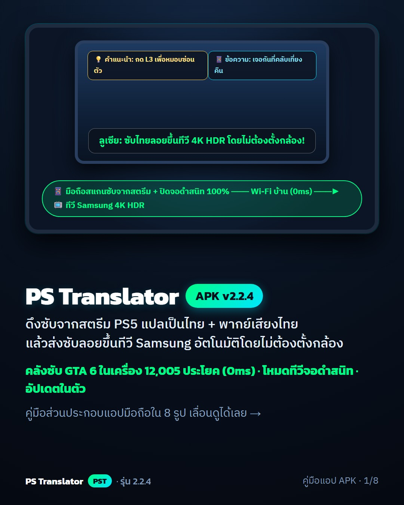
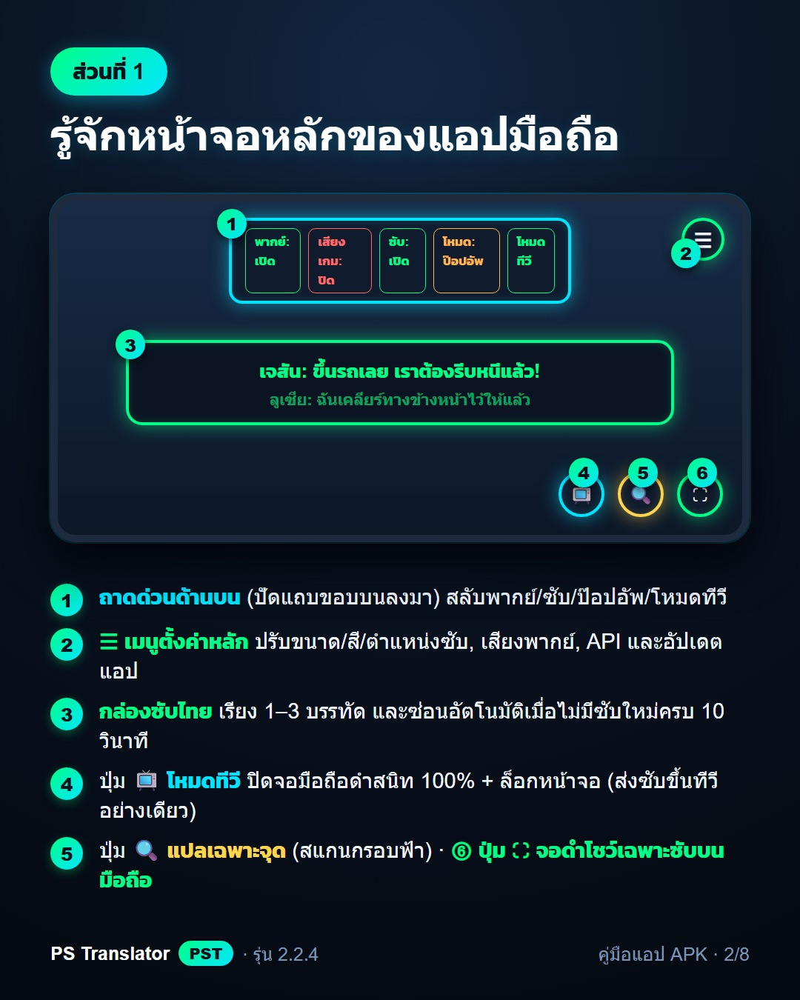
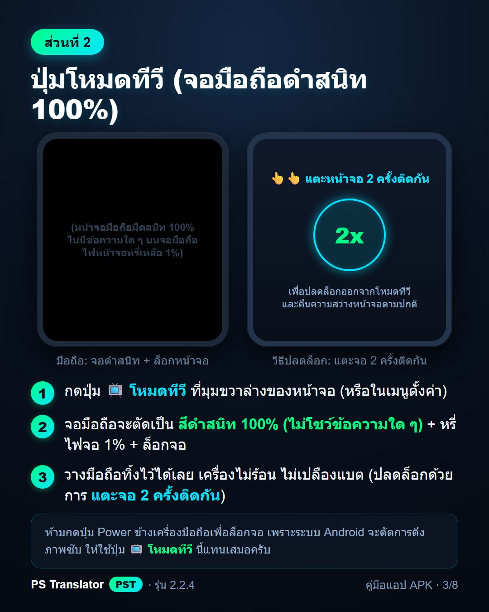
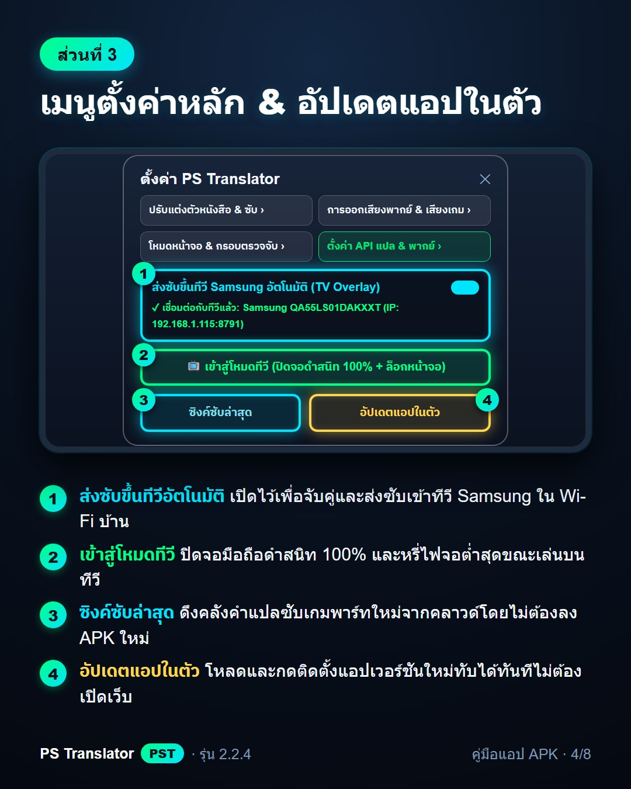
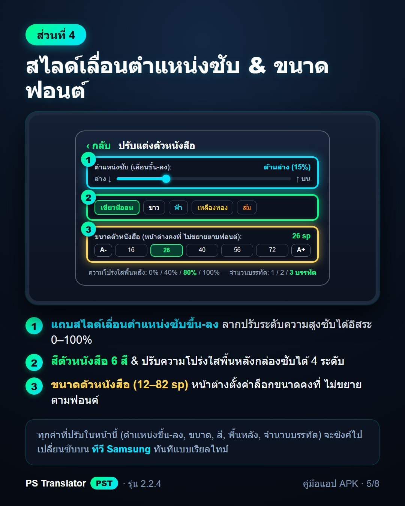
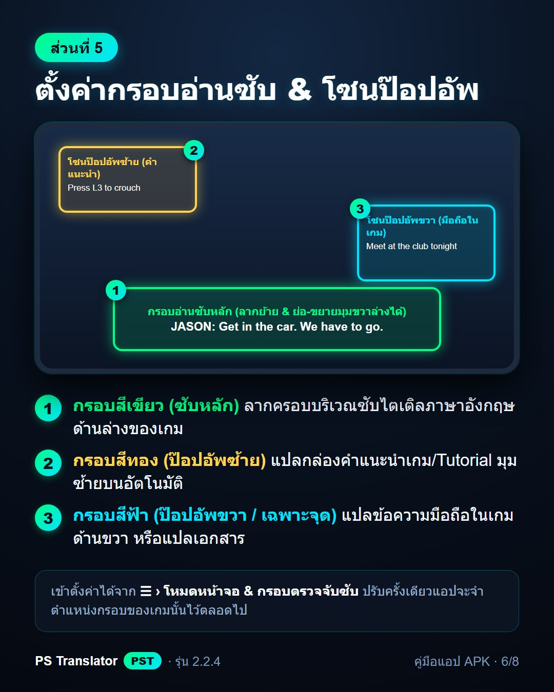
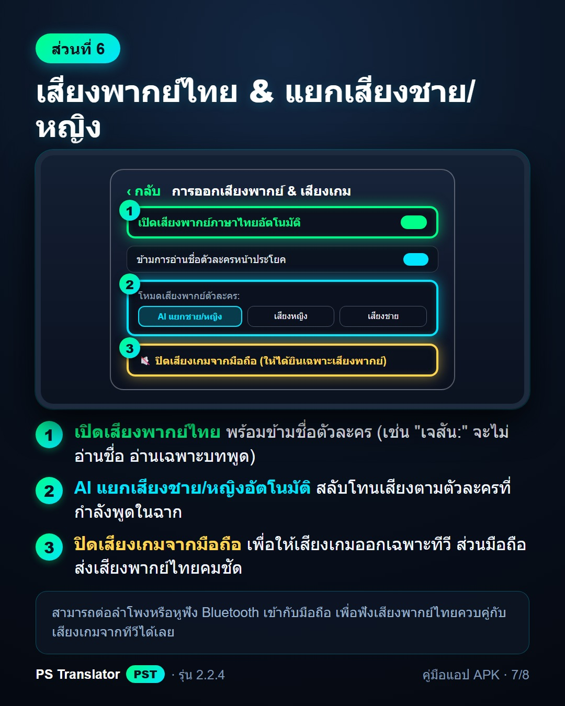
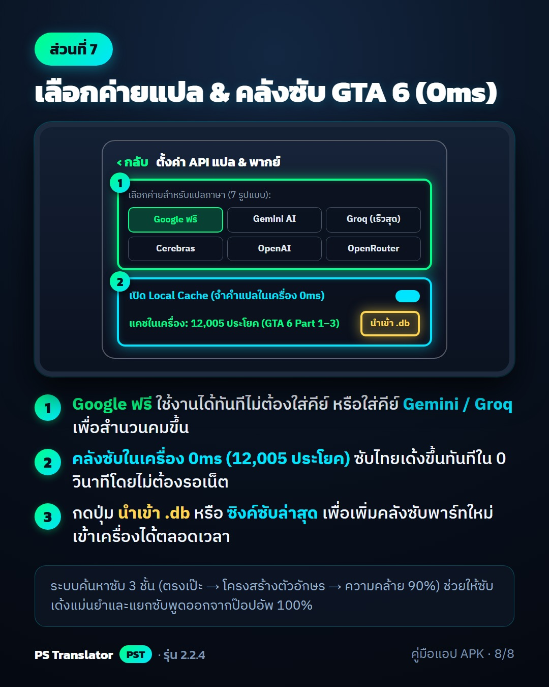

# วิธีใช้แอป PS Translator บนมือถือ (APK)

ยังไม่ได้ลงแอปบนทีวี Samsung: [คู่มือติดตั้งบนทีวี Samsung](../tv/samsung.md) · [ดาวน์โหลดแอปเวอร์ชันล่าสุด](https://github.com/teeradream/ps-translator/releases/latest)

---

## ส่วนที่ 1: รู้จักหน้าจอหลัก & ปุ่มลอยทั้งหมด

## ส่วนที่ 2: ปุ่มโหมดทีวี (ปิดจอมือถือดำสนิท 100% + ล็อกหน้าจอ)

## ส่วนที่ 3: เมนูตั้งค่าหลัก, ส่งซับขึ้นทีวี & อัปเดตแอปในตัว

## ส่วนที่ 4: แถบสไลด์เลื่อนตำแหน่งซับขึ้น-ลง & ขนาดฟอนต์

## ส่วนที่ 5: ตั้งค่ากรอบอ่านซับ, โซนป๊อปอัพซ้าย/ขวา & แปลเฉพาะจุด

## ส่วนที่ 6: เสียงพากย์ไทย & แยกเสียงชาย/หญิงอัตโนมัติ

## ส่วนที่ 7: เลือกค่าย AI แปลภาษา & คลังซับ GTA 6 ในเครื่อง (0ms)

