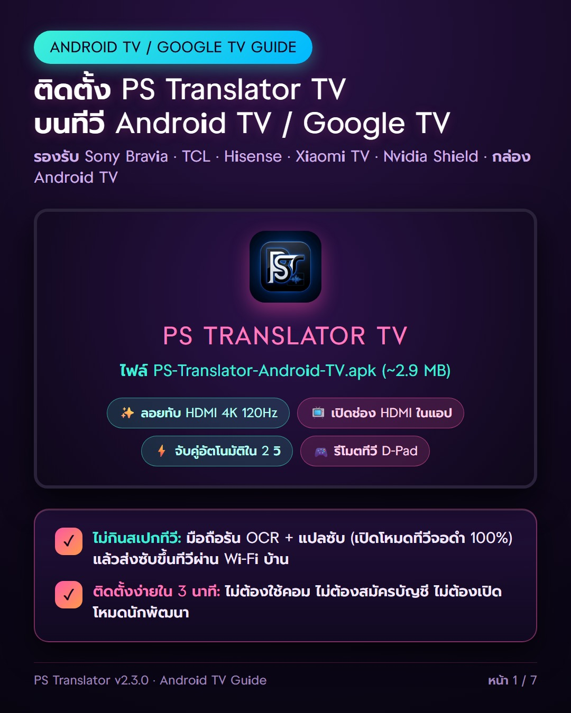
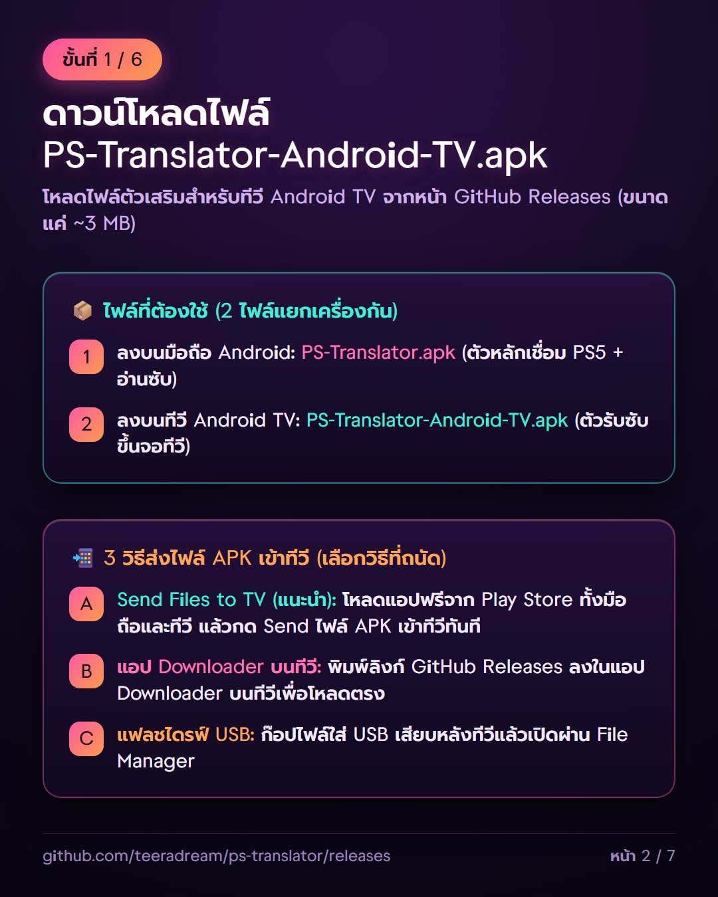
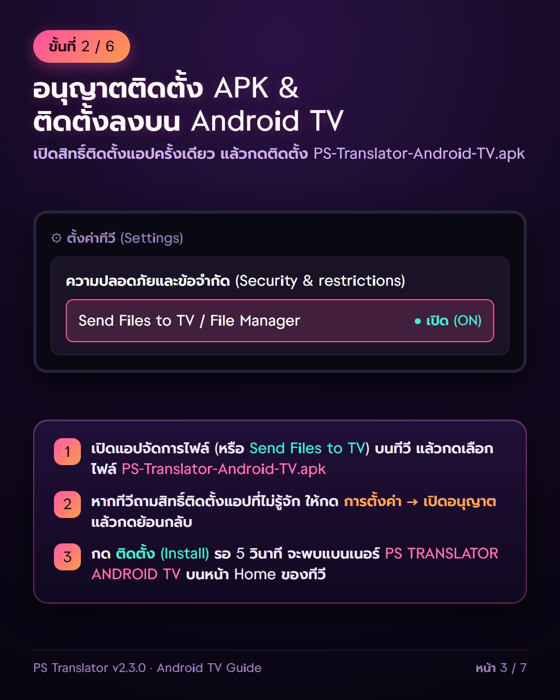
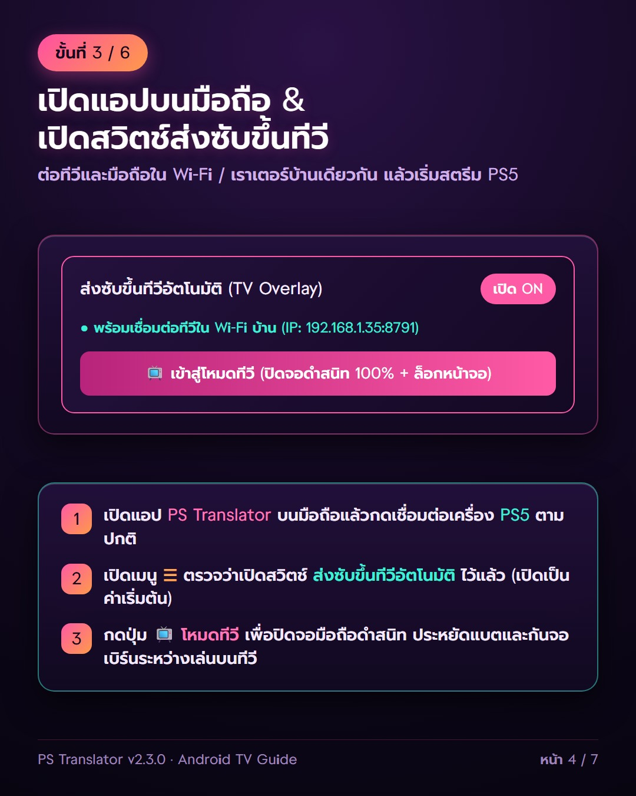
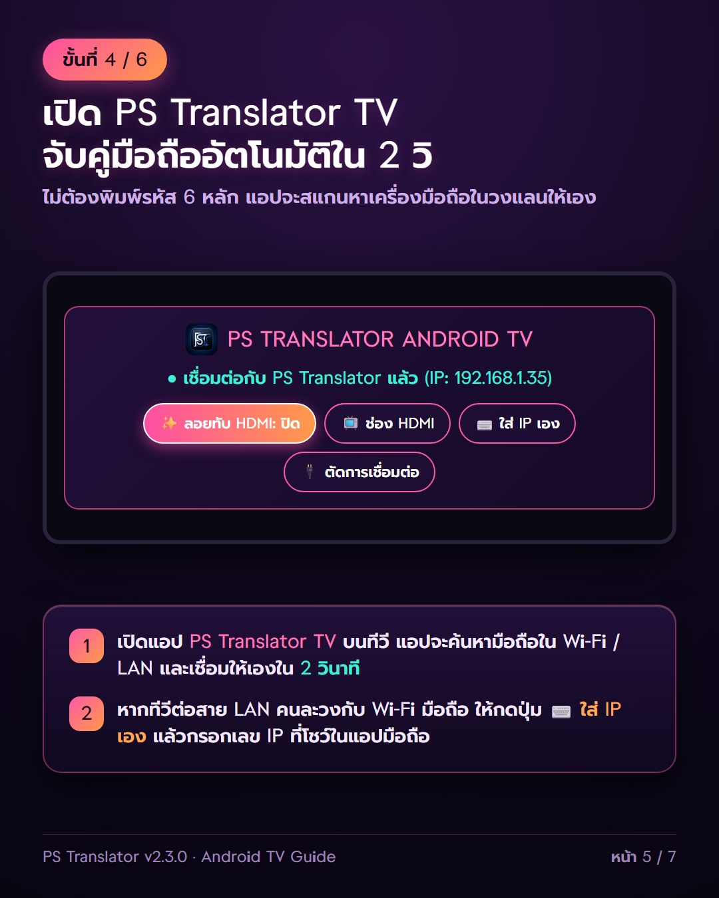
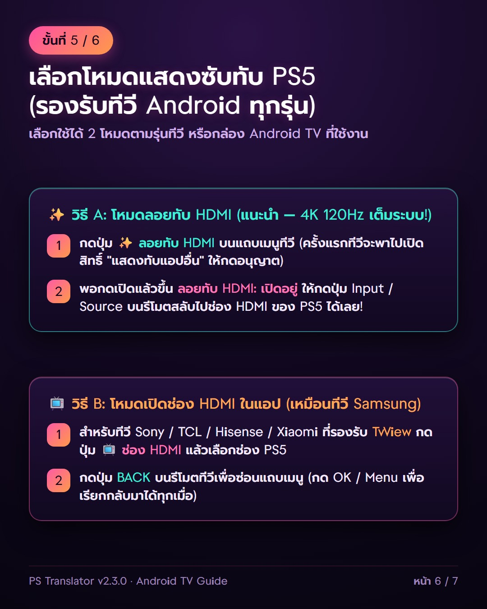
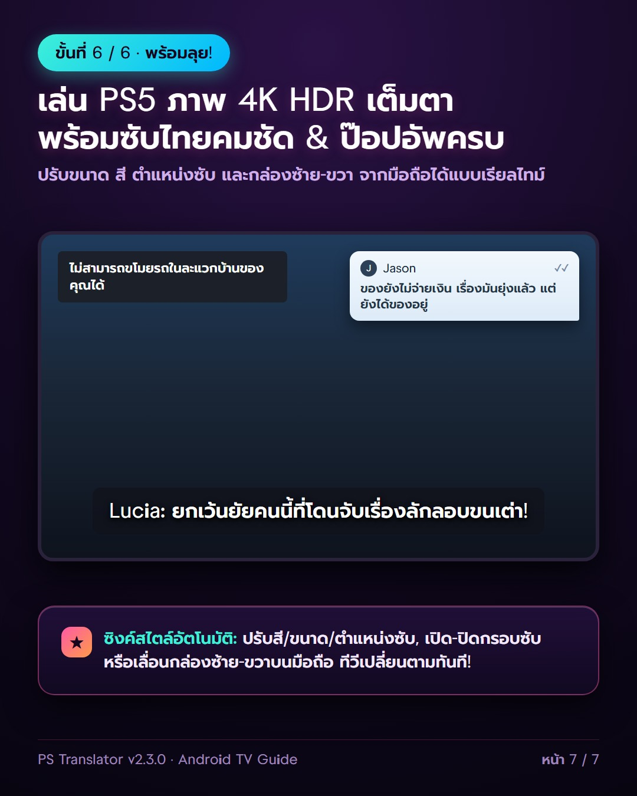

# ติดตั้งบนทีวี Android TV / Google TV

ใช้กับทีวี **Android TV / Google TV ทุกรุ่น** (Sony Bravia, TCL, Hisense, Xiaomi TV, Philips, Sharp) รวมถึง **Nvidia Shield และกล่อง Android TV Box** (รองรับภาพ **4K 120Hz HDR + Game Mode On** เต็มรูปแบบ)  
ใช้เวลาประมาณ 3 นาที ไม่ต้องใช้คอม ไม่ต้องเปิดโหมดนักพัฒนา ไม่ต้องสมัครบัญชีเพิ่ม

**ต้องมี**
- มือถือ Android ที่ลงแอป **PS Translator** รุ่นล่าสุด ([โหลดแอปที่นี่](https://github.com/teeradream/ps-translator/releases/latest) · [วิธีใช้แอปมือถือ](../phone/how-to-use.md))
- ทีวีกับมือถือต่อ **Wi-Fi / เราเตอร์บ้านเดียวกัน**
- PS5 เสียบสาย HDMI เข้าทีวีตามปกติ

**ไฟล์ที่ต้องโหลด**
1. แอปมือถือ **PS Translator**: [หน้าดาวน์โหลด](https://github.com/teeradream/ps-translator/releases/latest) เลือกไฟล์ **`PS-Translator.apk`**
2. แอปทีวี **PS Translator สำหรับ Android TV**: [หน้าดาวน์โหลด](https://github.com/teeradream/ps-translator/releases/latest) เลือกไฟล์ **`TV-PS-Translator-Android.apk`** *(ขนาด ~2.9 MB)*

---

## ขั้นที่ 1: โหลดไฟล์ `TV-PS-Translator-Android.apk` ส่งเข้าทีวี
เลือกวิธีส่งไฟล์เข้าทีวีที่สะดวกที่สุด:
- **วิธี A — แอป `Send Files to TV` (แนะนำ):** โหลดแอปฟรีจาก Play Store ทั้งบนมือถือและทีวี แล้วกด **Send** ส่งไฟล์ `TV-PS-Translator-Android.apk` จากมือถือเข้าทีวีทันที
- **วิธี B — แอป `Downloader` บนทีวี:** เปิดแอป Downloader บนทีวีแล้วโหลดจากหน้า [GitHub Releases](https://github.com/teeradream/ps-translator/releases/latest) โดยตรง
- **วิธี C — แฟลชไดรฟ์ USB:** ก๊อปไฟล์ใส่ USB เสียบหลังทีวีแล้วเปิดผ่าน File Manager

## ขั้นที่ 2: อนุญาตติดตั้ง APK และติดตั้งลงทีวี
1. บนทีวี: เปิดไฟล์ **`TV-PS-Translator-Android.apk`** ที่ส่งเข้ามา
2. หากทีวีถามสิทธิ์ติดตั้งแอปที่ไม่รู้จัก ให้กด **ตั้งค่า → เปิดอนุญาต** ให้แอปจัดการไฟล์ / `Send Files to TV` แล้วกดย้อนกลับ
3. กด **ติดตั้ง (Install)** เมื่อเสร็จจะเห็นแบนเนอร์ **`PS TRANSLATOR ANDROID TV`** บนหน้า Home ของทีวี

## ขั้นที่ 3: เปิดแอป PS Translator บนมือถือ & เปิดโหมดทีวี
1. เปิดแอป **`PS Translator`** บนมือถือแล้วกดเชื่อมต่อสตรีม **PS5** ตามปกติ
2. ตรวจในเมนู **`☰`** ว่าเปิดสวิตช์ **ส่งซับขึ้นทีวีอัตโนมัติ** ไว้แล้ว *(เปิดอยู่เป็นค่าเริ่มต้น)*
3. แนะนำกดปุ่ม **`📺 เข้าสู่โหมดทีวี`** เพื่อปิดจอมือถือดำสนิท 100% + ล็อกหน้าจอ (ประหยัดแบตและกันจอเบิร์นระหว่างเล่นบนทีวี)

## ขั้นที่ 4: เปิดแอป PS Translator TV บนทีวี (เชื่อมอัตโนมัติใน 2 วินาที)
1. เปิดแอป **`PS Translator TV`** บนทีวี Android TV
2. แอปจะสแกนหามือถือในวง Wi-Fi / LAN และเชื่อมต่อให้อัตโนมัติทันที (**ไม่ต้องกรอกรหัส 6 หลัก**) จนขึ้นสถานะสีมิ้นต์ **`● เชื่อมต่อกับ PS Translator แล้ว`**
3. หากทีวีต่อสาย LAN คนละวงกับ Wi-Fi มือถือ ให้กดปุ่ม **`⌨️ ใส่ IP เอง`** แล้วกรอกเลข IP ที่แสดงในแอปมือถือ

## ขั้นที่ 5: เลือกโหมดแสดงซับทับ PS5 (รองรับ 2 โหมด)
- **✨ โหมด A: `ลอยทับ HDMI` (แนะนำ — เล่น 4K 120Hz Game Mode ได้เต็มระบบ!)**
  1. กดปุ่ม **`✨ ลอยทับ HDMI`** บนแถบเมนูทีวี (ครั้งแรกทีวีจะพาไปหน้าสิทธิ์ **"แสดงทับแอปอื่น"** ให้กดเปิดอนุญาต 1 ครั้ง)
  2. เมื่อขึ้นว่า **`✨ ลอยทับ HDMI: เปิดอยู่`** ให้กดปุ่ม **Input / Source** บนรีโมตทีวีสลับไปช่อง **HDMI ของ PS5** ได้เลย ซับไทยจะลอยทับภาพเกม PS5 ทันที!
- **📺 โหมด B: `เลือกช่อง HDMI` (เปิดภาพ HDMI ในแอปเหมือนทีวี Samsung)**
  1. สำหรับทีวี Android TV ที่รองรับ `TvView` (เช่น Sony, TCL, Hisense, Xiaomi) กดปุ่ม **`📺 ช่อง HDMI`** แล้วเลือกช่องที่ต่อ PS5
  2. กดปุ่ม **`BACK`** บนรีโมตเพื่อซ่อนแถบเมนู *(กด **`OK`** หรือ **`MENU`** เพื่อเรียกเมนูกลับมาได้ทุกเมื่อ)*

## ขั้นที่ 6: เล่นเกม 4K HDR พร้อมซับไทยคมชัด & ปรับแต่งสดจากมือถือ
- ซับไทยหลัก (ฟอนต์หนาพร้อมเงาคมชัด), กล่องคำแนะนำฝั่งซ้ายสีเทาเข้ม และกล่องแชทฝั่งขวาจะลอยขึ้นบนจอทีวีแบบเรียลไทม์
- สามารถปรับ **ขนาด สี ตำแหน่งซับ เปิด/ปิดกรอบซับ และเลื่อนตำแหน่งกล่องซ้าย-ขวา** จากแอปมือถือแล้วทีวีจะเปลี่ยนตามทันทีโดยไม่ต้องอัปเดตแอปทีวีใหม่!

