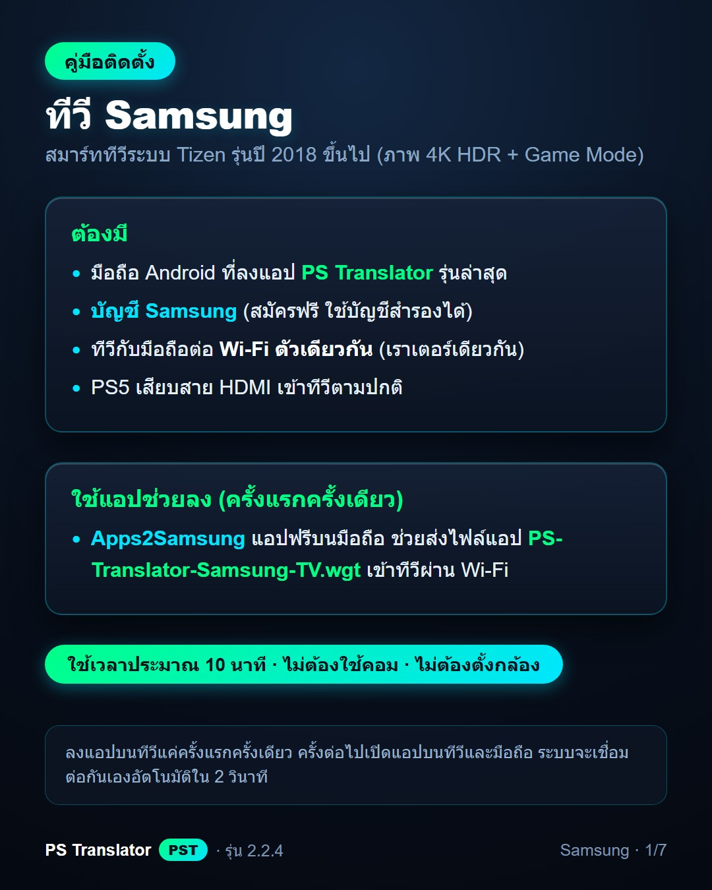
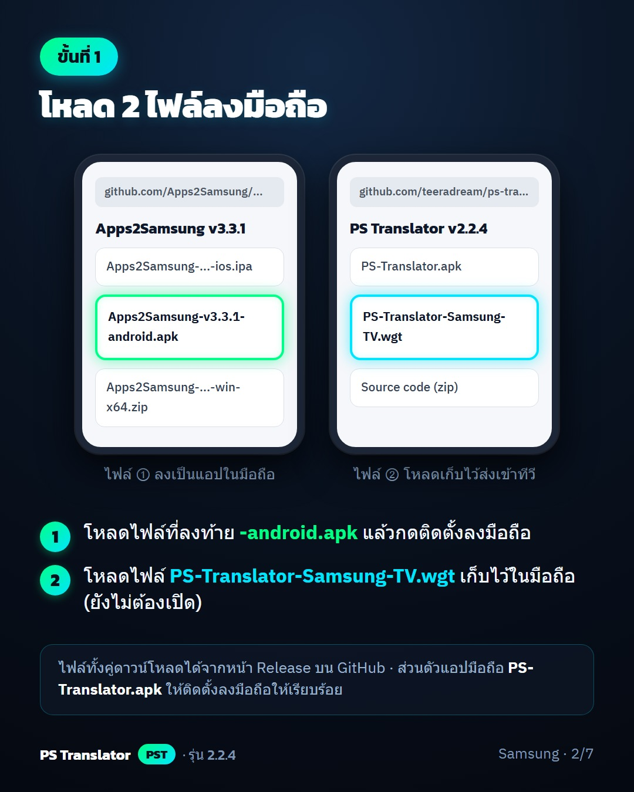
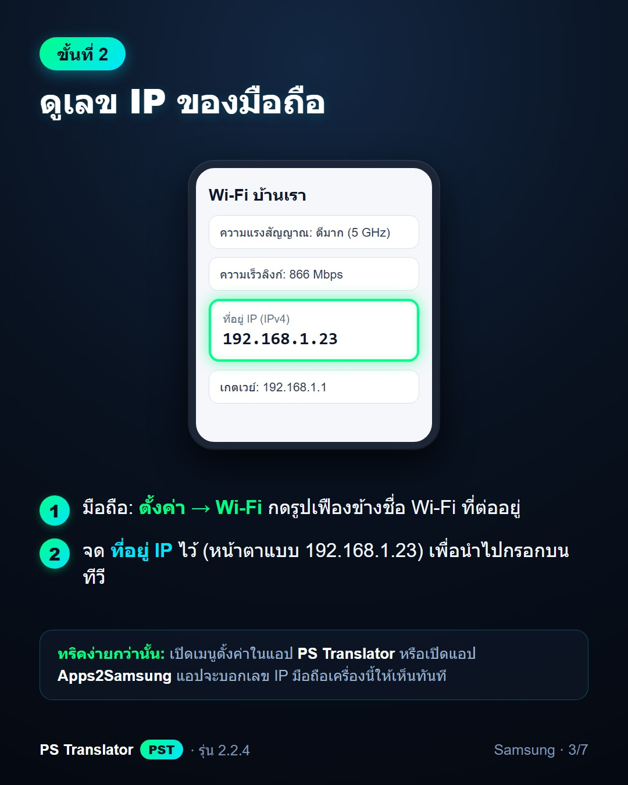
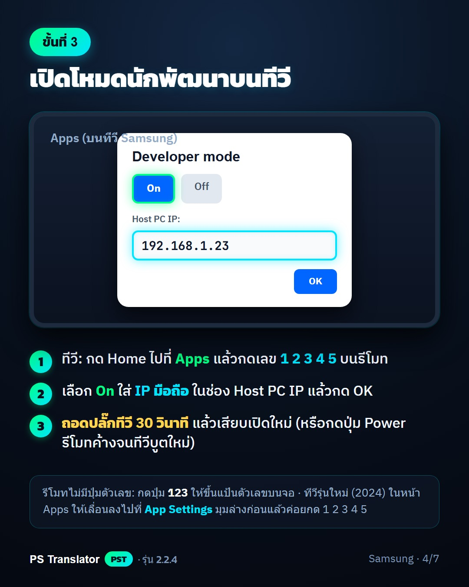
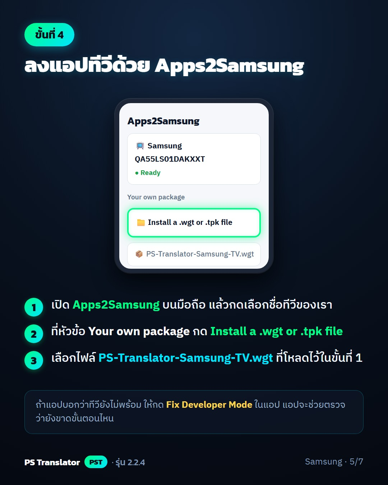
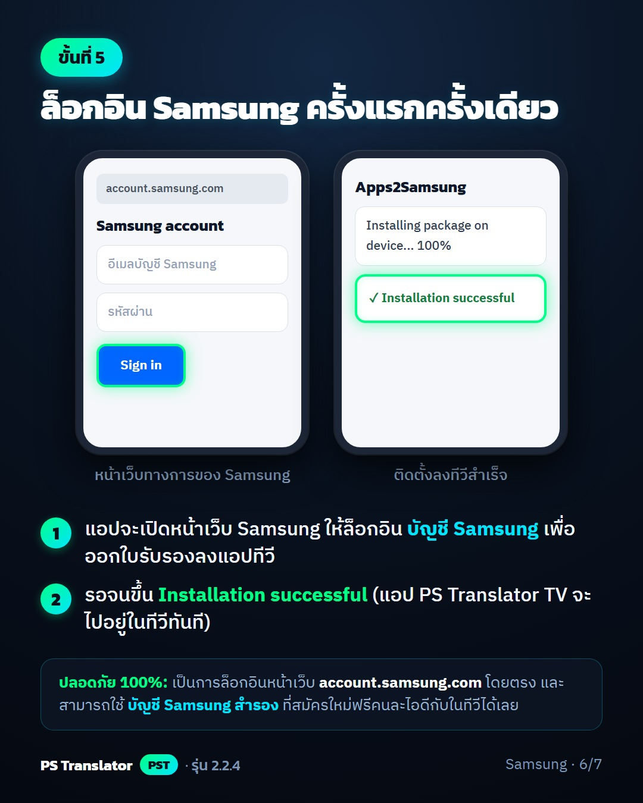
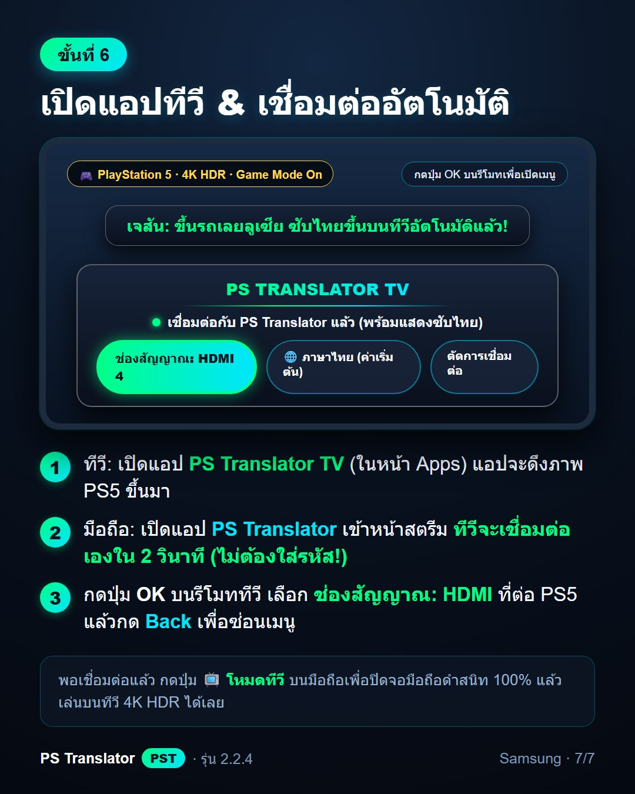

# ติดตั้งบนทีวี Samsung

ใช้กับสมาร์ททีวี Samsung ระบบ **Tizen รุ่นปี 2018 ขึ้นไป** (รองรับภาพ **4K HDR + Game Mode On** เต็มรูปแบบ)  
ใช้เวลาประมาณ 10 นาที ไม่ต้องใช้คอม ไม่ต้องตั้งกล้อง ทำจากมือถือ Android ได้เลย

**ต้องมี**
- มือถือ Android ที่ลงแอป **PS Translator** รุ่นล่าสุด ([โหลดแอปที่นี่](https://github.com/teeradream/ps-translator/releases/latest) · [วิธีใช้แอปมือถือ](../phone/how-to-use.md))
- **บัญชี Samsung** ของตัวเอง ([สมัครฟรี](https://account.samsung.com) — ใช้บัญชีสำรองคนละไอดีกับในทีวีได้)
- ทีวีกับมือถือต่อ **Wi-Fi ตัวเดียวกัน** (เราเตอร์เดียวกัน)
- PS5 เสียบสาย HDMI เข้าทีวีตามปกติ

**ไฟล์ที่ต้องโหลด**
1. แอป **Apps2Samsung** สำหรับมือถือ: [หน้าดาวน์โหลด](https://github.com/Apps2Samsung/Apps2Samsung/releases/latest) เลือกไฟล์ที่ลงท้าย **`-android.apk`** (แอปโอเพนซอร์สฟรี ช่วยส่งไฟล์เข้าทีวี Samsung)
2. แอปทีวี **PS Translator สำหรับ Samsung**: [หน้าดาวน์โหลด](https://github.com/teeradream/ps-translator/releases/latest) เลือกไฟล์ **`PS-Translator-Samsung-TV.wgt`**

---

## ขั้นที่ 1: โหลด 2 ไฟล์ลงมือถือ
- โหลดไฟล์ที่ลงท้าย **`-android.apk`** แล้วกดติดตั้งลงมือถือ
- โหลดไฟล์ **`PS-Translator-Samsung-TV.wgt`** เก็บไว้ในมือถือ (ยังไม่ต้องเปิด)

## ขั้นที่ 2: ดูเลข IP ของมือถือ
มือถือ: **ตั้งค่า → Wi-Fi** แล้วกดรูปเฟือง ⚙ ข้างชื่อ Wi-Fi ที่ต่ออยู่ จด **ที่อยู่ IP** ไว้ (หน้าตาแบบ `192.168.1.23`) · ในเมนูตั้งค่าของแอป **PS Translator** และแอป **Apps2Samsung** ก็มีบอกเลข IP นี้ให้เช่นกัน

## ขั้นที่ 3: เปิดโหมดนักพัฒนาบนทีวี
1. ทีวี: กด Home แล้วไปที่ **Apps** จากนั้นกดเลข **`1 2 3 4 5`** บนรีโมท
   - ถ้ารีโมทไม่มีปุ่มตัวเลข ให้กดปุ่ม **`123`** เพื่อให้แป้นตัวเลขขึ้นบนจอ
   - ทีวีรุ่นใหม่ ๆ (2024) ให้เลื่อนลงไปที่ **App Settings** ในหน้า Apps ก่อน แล้วค่อยกด `1 2 3 4 5`
2. เลือก **`On`** ใส่ **IP มือถือ** ในช่อง **Host PC IP** แล้วกด OK
3. **ถอดปลั๊กทีวี 30 วินาที** แล้วเสียบเปิดใหม่ (หรือกดปุ่ม Power บนรีโมทค้าง 2 วินาทีจนทีวีบูตใหม่)

## ขั้นที่ 4: ลงแอปทีวีด้วย Apps2Samsung
1. เปิด **Apps2Samsung** บนมือถือ แล้วกดชื่อทีวีของเราที่ขึ้นในแอป
2. ที่หัวข้อ **Your own package** กด **`Install a .wgt or .tpk file`**
3. เลือกไฟล์ **`PS-Translator-Samsung-TV.wgt`** ที่โหลดไว้

ถ้าแอปบอกว่าทีวียังไม่พร้อม ให้กด **Fix Developer Mode** แอปจะบอกว่ายังขาดขั้นไหน

## ขั้นที่ 5: ล็อกอิน Samsung ครั้งแรกครั้งเดียว
แอปจะเปิดหน้าเว็บทางการของ Samsung (`account.samsung.com`) ให้ล็อกอิน **บัญชี Samsung** เพื่อออกใบรับรองสำหรับลงแอปทีวี จากนั้นรอจนขึ้น **`Installation successful`**

*(สามารถใช้บัญชี Samsung สำรองที่สมัครใหม่ฟรีคนละไอดีกับในทีวีหรือมือถือหลักได้เลย)*

## ขั้นที่ 6: เปิดแอปทีวี & เชื่อมต่ออัตโนมัติ (ไม่ต้องใส่รหัส 6 หลัก)
1. ทีวี: เปิดแอป **`PS Translator TV`** (อยู่ในหน้า Apps — กดค้างเพื่อเพิ่มไปยังหน้าหลักได้)
2. มือถือ: เปิดแอป **`PS Translator`** เข้าหน้าสตรีม PS5 **ทีวีจะจับคู่เข้าหน้าจอเกมให้อัตโนมัติภายใน 2 วินาทีโดยไม่ต้องกรอกรหัส 6 หลัก!**
3. ตอนเล่นเกม: กดปุ่ม **`OK`** บนรีโมททีวี เลือก **`ช่องสัญญาณ: HDMI`** ที่ต่อ PS5 แล้วกด **`Back`** บนรีโมทเพื่อซ่อนเมนูและเล่นเกม **4K HDR + Game Mode On** พร้อมซับไทยลอยบนจอได้เลย

